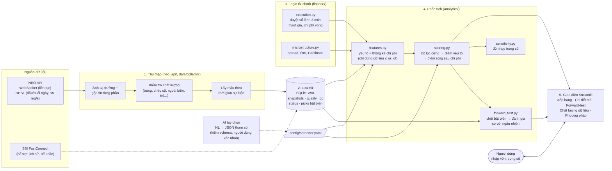

# Thiết kế sản phẩm ExecScreen

## 1. Vấn đề và người dùng
**Vấn đề.** Nhà đầu tư cá nhân dùng bộ lọc cổ phiếu xếp hạng theo giá/khối lượng nhưng thường bỏ qua câu hỏi
*"với số vốn của tôi, vào/ra mã này tốn bao nhiêu?"*. Một mã tín hiệu đẹp nhưng spread rộng, sổ lệnh mỏng có thể
mất phần lớn lợi thế vào chi phí thực thi. Bộ lọc thông dụng coi "thanh khoản" là khối lượng giao dịch, không phải
chi phí giao dịch ở một quy mô lệnh cụ thể.

**Người dùng mục tiêu.** (1) Nhà đầu tư cá nhân vốn từ vài chục triệu đến vài tỷ đồng; (2) chuyên viên phân tích muốn
một lát cắt "mã nào đủ khả năng giao dịch" trước khi nghiên cứu sâu.

**Giá trị.** Xếp hạng theo điểm tín hiệu *ròng sau chi phí thực thi*, kèm lý do từng mã bị loại, và bằng chứng
forward-test để người dùng biết bộ lọc đã được kiểm chứng đến đâu (và đến đâu thì chưa).

**Phi mục tiêu.** Không dự báo giá, không khuyến nghị mua/bán, không tự động giao dịch.

## 2. Kiến trúc

Chuỗi bắt buộc theo đề: NEO API → thu thập → chuẩn hóa/lưu trữ → logic tài chính → phân tích → giao diện → người dùng.
Không bỏ lớp nào (có lưu trữ vì cần lịch sử nhiều phiên cho RVOL, ADV, forward-test).

| Lớp | Thư mục | Nhiệm vụ |
|---|---|---|
| Thu thập | `neo_api/`, `data/collector.py` | Kết nối WebSocket, tự kết nối lại, giới hạn tần suất, ánh xạ trường, gộp tin từng phần |
| Chất lượng | `data/quality.py` | Loại tin xấu (trùng, đảo thứ tự, sổ chéo, ngoài biên, giảm cộng dồn...), gắn cờ (thiếu chào, tin muộn, ngoài phiên) và đếm |
| Lưu trữ | `data/storage.py` | SQLite WAL; `UNIQUE(symbol, ts, source)` chống trùng; bảng `picks` bất biến bằng trigger |
| Logic tài chính | `finance/` | Bước giá/lô, phí, spread, OBI, **duyệt sổ lệnh** |
| Phân tích | `analytics/` | Yếu tố theo thời điểm, bộ lọc cứng, điểm ròng, độ nhạy, forward-test |
| Giao diện | `app/` | FastAPI + Jinja2, một trang web với 5 khu vực nội dung |
| Cấu hình | `config/screener.yaml` | Toàn bộ tham số; không hard-code trong mã |

**Luồng dữ liệu trong phiên.** WebSocket → `FieldMapper` (tên trường NEO → tên chuẩn, quy đổi đơn vị) →
`StateMerger` (gộp các loại tin thành snapshot đầy đủ theo mã) → `QualityChecker` → `Sampler` (mỗi mã giữ snapshot
cuối của mỗi khoảng `interval_s`, theo thời gian sự kiện) → SQLite. Giao diện/phân tích **chỉ đọc** CSDL, nên tách
được tiến trình thu thập khỏi tiến trình hiển thị.

**Vì sao lấy mẫu thay vì lưu mọi tin.** Với 100 mã, lưu mọi tin tạo hàng triệu dòng/ngày; chi phí thực thi chỉ cần
chuỗi snapshot đủ dày (5-30 giây) để lấy trung vị và P90. Có thể bật `--raw-log` để giữ tin thô vài phiên phục vụ kiểm toán.

## 3. Chức năng
1. **Bộ lọc nhiều yếu tố** (cấu hình được): `mom_ref`, `range_pos`, `rvol_tod`, `obi3`, `range_pct`, `foreign_net` (tùy chọn).
2. **Phương án A - thanh khoản thực thi**: nhập vốn → với mỗi mã tính trượt giá mua/bán, độ phủ sổ lệnh,
   tỷ lệ snapshot vượt độ sâu, chi phí vòng P50/P90; dùng làm bộ lọc cứng và làm phần phạt trong điểm ròng.
3. **Phương án B - forward-test**: chốt danh sách bất biến mỗi phiên → đánh giá sau h phiên bằng giá thực thi
   từ sổ lệnh, trừ phí và thuế, so với (a) trung bình mọi mã đủ điều kiện, (b) 2.000 rổ ngẫu nhiên cùng quy mô,
   kèm IC hạng và khoảng tin cậy bootstrap.
4. **Giải thích**: mỗi mã có đóng góp từng yếu tố, lý do bị loại, minh họa lệnh "ăn" sổ lệnh.
5. **Yêu cầu nhanh** (tùy chọn): "vốn 300 triệu, top 8, ưu tiên khối lượng" → tham số (quy tắc; có thể gắn LLM).

## 4. Giao diện (đáp ứng Mục 6 của đề)
| Yêu cầu đề | Nơi đáp ứng |
|---|---|
| Tên, mục tiêu, người dùng | Tiêu đề + chú thích đầu trang |
| Thời điểm cập nhật, trạng thái kết nối | 3 chỉ số đầu trang (cập nhật lần cuối, tuổi dữ liệu, kết nối thu thập) |
| ≥ 3 chỉ số tổng hợp | Tab Xếp hạng: số mã đủ điều kiện, chi phí vòng P50 trung vị, số mã bị loại vì vượt độ sâu, độ rộng tăng/giảm |
| ≥ 2 trực quan | Scatter điểm-chi phí + đường biên hiệu quả; cột độ sâu "lệnh ăn sổ"; chuỗi chi phí theo giờ; đóng góp yếu tố; lợi suất forward-test |
| Bộ lọc/lựa chọn | Vốn, ngày/giờ phân tích, trọng số, lọc mã, hiện mã bị loại |
| Khu phân tích/xếp hạng/giải thích | Bảng xếp hạng + tab Chi tiết mã |
| Phương pháp và giới hạn | Tab cuối |
| Xử lý không có dữ liệu/lỗi | Chưa có CSDL, chưa có snapshot tại giờ chọn, lỗi tính toán → thông báo rõ, không treo; dữ liệu mô phỏng → cảnh báo đỏ |

## 5. Lựa chọn công nghệ
Python 3.11+; pandas/numpy/scipy (tính toán vector hóa); SQLite WAL (không cần máy chủ, một ghi - nhiều đọc);
FastAPI + Jinja2 + Plotly (giao diện web chạy trên trình duyệt); pydantic (kiểm schema cho lớp AI); pytest.
Không dùng học máy: dữ liệu 5-10 phiên không đủ để huấn luyện và đánh giá ngoài mẫu một cách đáng tin; mô hình phức tạp
không được cộng điểm theo đề.

## 6. Xử lý lỗi và vận hành
- Mất kết nối: kết nối lại với lùi tăng dần (1→60 giây, có nhiễu), ghi trạng thái `connected=false` và lỗi gần nhất.
- Tin không đọc được: bỏ qua, đếm `parse_errors`, không làm sập luồng.
- REST: giới hạn 5 yêu cầu/giây (token bucket), thử lại có lùi với 429/5xx, 4xx khác báo lỗi ngay.
- Token JWT: đọc hạn `exp`, hỗ trợ hàm làm mới; không bao giờ ghi token vào log (chỉ `mask`).
- Dữ liệu cũ: cờ `stale` → bị loại khỏi xếp hạng; giao diện hiện tuổi dữ liệu.

## 7. Bảo mật và an toàn
Khóa chỉ trong `.env` (đã nằm trong `.gitignore`); `.env.example` không có giá trị thật; không có hàm gửi lệnh nào
trong mã nguồn; mọi "giao dịch" của forward-test là phép tính trên dữ liệu sổ lệnh đã lưu. Mọi màn hình có tuyên bố học thuật.

## 8. Điểm khác biệt có thể bảo vệ
- Đơn vị phân tích là **tín hiệu ròng chi phí ở quy mô vốn của người dùng**, không phải bảng xếp hạng chung.
- Tự kiểm chứng: danh sách bất biến, ngưỡng cố định từ phiên hiệu chỉnh, so với rổ ngẫu nhiên; báo cáo trung thực khi không có lợi thế.
- Kiểm tra "chống nhìn trước" bằng test tự động (đầu độc dữ liệu tương lai không làm đổi kết quả).
- Gắn cờ thay vì đoán khi sổ lệnh không đủ độ sâu.
